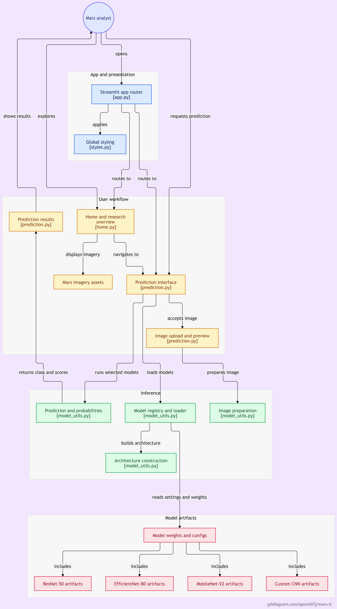
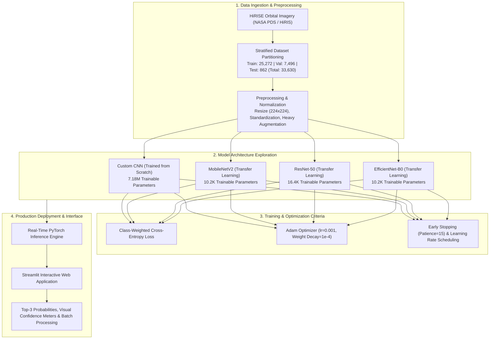

# Mars Landform Classification (MLC)

> An end-to-end deep learning framework and interactive Streamlit web platform for automated planetary geological analysis and landform classification from high-resolution Martian orbital imagery.

---

## Overview

Planetary exploration missions generate extensive volumes of high-resolution orbital imagery. Analyzing Martian geomorphology manually is labor-intensive, time-consuming, and subject to observer bias. 

This project implements an automated, computer vision-based classification pipeline evaluated across 33,630 orbital image tiles captured by the High Resolution Imaging Science Experiment (HiRISE) camera aboard NASA's Mars Reconnaissance Orbiter (MRO). The system benchmarks a custom convolutional neural network (CNN) trained from scratch against three transfer learning architectures (MobileNetV2, ResNet-50, and EfficientNet-B0), packaged into an interactive Streamlit web application for real-time inference, multi-model evaluation, and confidence assessment.

---

## Target Landform Classes

The classification system recognizes 8 distinct geomorphological classes on the Martian surface:

1. **Other:** Background terrain, complex overlapping surfaces, and unclassified geological formations.
2. **Crater:** Circular depressions formed by hypervelocity meteorite and asteroid impacts.
3. **Dark Dune:** Basaltic sand dunes sculpted by aeolian wind dynamics.
4. **Slope Streak:** Narrow, dark gravity-driven mass wasting features occurring on steep dust-covered slopes.
5. **Bright Dune:** Lighter-toned sand dunes composed of distinct mineralogical compositions.
6. **Impact Ejecta:** Debris and structural patterns radially thrown outward from an impact site.
7. **Swiss Cheese:** Pitted circular depressions in the Martian South Polar carbon dioxide ice cap.
8. **Spider (Araneiform):** Radially branching dendritic troughs carved by seasonal gas sub-surface sublimation beneath polar ice.

---

## System Architecture and Pipeline Flowchart

The high-level end-to-end workflow from dataset ingestion to interactive deployment:



### Methodological Workflow



---

## Dataset Specifications

The experiments utilize the standard benchmark Martian orbital terrain dataset:

- **Source:** NASA Planetary Data System (PDS) / HiRISE
- **Total Valid Samples:** 33,630 images
  - **Training Set:** 25,272 samples (75.1%)
  - **Validation Set:** 7,496 samples (22.3%)
  - **Test Set:** 862 samples (2.6%)
- **Tile Dimensions:** 224 x 224 pixels, RGB / Grayscale normalized

### Handling Class Imbalance
The dataset exhibits heavy class imbalance; the background `other` category represents over 70% of total samples, while geological classes like `spider`, `impact ejecta`, and `slope streak` are sparsely distributed. To address this:
- **Class-Weighted Cross-Entropy Loss:** Penalizes misclassifications on minority categories proportionally to their inverse frequencies.
- **Stratified Partitioning:** Preserves exact class distributions across training, validation, and test splits.
- **Data Augmentation:** Random rotations, horizontal and vertical flips, affine transformations, and perspective shifts applied dynamically during training.

---

## Experimental Configurations and Results

All models were evaluated under uniform criteria: 50 epochs, batch size 32, image resolution 224x224, learning rate 0.001 with Adam optimizer, weight decay 1e-4, and identical train/val/test splits.

### Overall Benchmark Comparison

| Model Architecture | Trainable Parameters | Best Val Accuracy | Test Accuracy | Weighted Precision | Weighted Recall | Weighted F1-Score |
| :--- | :---: | :---: | :---: | :---: | :---: | :---: |
| **MobileNetV2** | 10,248 | 79.39% | **85.27%** | 86.56% | 85.27% | 85.48% |
| **ResNet-50** | 16,392 | **82.03%** | 85.15% | **87.78%** | 85.15% | **86.16%** |
| **EfficientNet-B0** | 10,248 | 75.19% | 77.84% | 86.87% | 77.84% | 81.21% |
| **Custom CNN (from scratch)** | 7,183,432 | 24.59% | 26.45% | 75.48% | 26.45% | 35.11% |

### Key Experimental Insights

1. **Transfer Learning Superiority:** Pretrained ImageNet backbones substantially outperformed training from scratch. Transfer learning representations generalized effectively to planetary geological structures despite domain shifts.
2. **Top Performers:** 
   - **ResNet-50** achieved the highest overall Weighted F1-Score (0.8616) and Weighted Precision (0.8778).
   - **MobileNetV2** attained the highest Test Accuracy (85.27%) while maintaining an ultra-compact footprint (only 10,248 trainable parameters in the classification head), making it the optimal candidate for resource-constrained edge deployments.
3. **Class-Specific Detection:** Common terrain classes (`other`, `dark dune`, `swiss cheese`) demonstrated high F1-scores (>0.82 to 0.92). Minority feature detection (`impact ejecta` and `spider`) remains the primary open research challenge.

---

## Streamlit Application Features

The repository includes a production-ready web application built with Streamlit:

- **Single and Batch Image Upload:** Accepts JPEG, PNG, and TIFF satellite crops.
- **Real-Time Classification:** Instant inference displaying top predicted geological class.
- **Confidence Distribution:** Interactive probability breakdown for top-3 candidate classes.
- **Geomorphological Information Panels:** Detailed geological context explaining the genesis of predicted landforms.
- **Sample Image Gallery:** Pre-packaged test imagery representing each of the 8 classes for one-click testing.

---

## Project Structure

```text
Mars-Landform-Classification/
├── assets/                  # Application branding, visual assets, and style sheets
├── MODELS/                  # Exported PyTorch model checkpoints (.pth)
├── Sample Images for Test/  # Representative HiRISE images across all 8 classes
├── ui/                      # Streamlit custom UI components and layouts
├── utils/                   # Model loading, image transformation, and inference utilities
├── views/                   # Application multi-page views (Inference, Analytics, About)
├── app.py                   # Main Streamlit web application entrypoint
├── MLC.png                  # System architecture and pipeline diagram
├── requirements.txt         # Production runtime dependencies
└── README.md                # Project documentation
```

---

## Installation and Local Setup

### Prerequisites
- Python 3.10 or higher
- pip package manager

### Setup Steps

```bash
# Clone the repository
git clone https://github.com/QASIM07J/MARS-LC.git
cd MARS-LC

# Create and activate a virtual environment
# Windows:
python -m venv venv
venv\Scripts\activate
# Linux / macOS:
python3 -m venv venv
source venv/bin/activate

# Install required dependencies
pip install -r requirements.txt

# Launch the Streamlit application
streamlit run app.py
```

Access the interface locally at `http://localhost:8501`.

---

## Technologies Used

- **Deep Learning Framework:** PyTorch, Torchvision
- **Architectures:** ResNet-50, MobileNetV2, EfficientNet-B0, Custom Deep CNN
- **Scientific Computing:** NumPy, Pandas, Scikit-learn
- **Image Processing:** OpenCV, Pillow (PIL)
- **Data Visualization:** Matplotlib, Seaborn, Plotly
- **Web Framework:** Streamlit
- **Data Source:** NASA Planetary Data System (PDS) / HiRISE Camera (MRO)

---

## Author

- **Author:** [Muhammad Qasim](https://github.com/QASIM07J)
- **Profile:** [LinkedIn](https://www.linkedin.com/in/muhammad-qasim-59604323b) | [GitHub](https://github.com/QASIM07J)
- **Field:** Data Science, Deep Learning, Computer Vision

---

## License

This project is licensed under the MIT License - see the [LICENSE](LICENSE) file for details.
